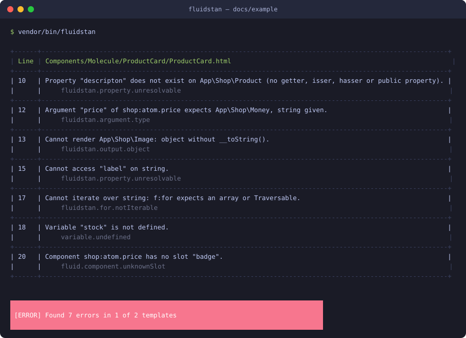

# FluidStan

<picture>
  <source media="(prefers-color-scheme: dark)" srcset="docs/logo-dark.svg">
  
</picture>

<a href="https://www.flowd.de">
  <picture>
    <source media="(prefers-color-scheme: dark)" srcset="https://www.flowd.de/assets/logo/flowd-logo-white.svg">
    
  </picture>
</a>

<hr />

Static analysis for [TYPO3 Fluid](https://github.com/TYPO3/Fluid) templates and components, powered by
[PHPStan](https://phpstan.org). Developed and maintained by [Flowd GmbH](https://flowd.de).

<p>
  <a href="https://github.com/fluidstan/fluidstan/actions/workflows/ci.yml"></a>
  <a href="https://packagist.org/packages/fluidstan/fluidstan"></a>
  <a href="LICENSE"></a>
</p>



FluidStan knows the PHP types behind your template variables and reports what Fluid would only reveal at
runtime. The screenshot shows the analysis of [`docs/example`](docs/example), a product card component
with a typo in a property path, a wrong argument type, an object rendered without `__toString()`, a loop
over a string, an undefined variable and an unknown slot. Run it yourself with `composer fluidstan:example`.

It reports:

- property paths that cannot be resolved (`{item.nonexistent}`), following Fluid's lookup order:
  array key, `ArrayAccess`, PSR container, getter, isser, hasser, public property
- values that cannot be rendered (`{item.money}` where `Money` has no `__toString()`, arrays)
- `f:for` over something that is not iterable
- ViewHelper and component arguments whose type does not satisfy the argument definition, with the
  same rules Fluid's `StrictArgumentProcessor` applies at runtime. Note that Fluid casts scalars
  before validating: a string passed to an `int` argument, or a float to a `string`, is accepted at
  runtime and therefore not reported; objects, arrays and `null` for required arguments are. See
  [`StrictArgumentProcessor::process()`](https://github.com/TYPO3/Fluid/blob/main/src/Core/ViewHelper/StrictArgumentProcessor.php)
  and its use in [`ViewHelperInvoker`](https://github.com/TYPO3/Fluid/blob/main/src/Core/ViewHelper/ViewHelperInvoker.php).
- non-numeric operands in `{a + b}`
- undefined variables in components (their scope is closed)
- unknown ViewHelpers, unknown or missing arguments, syntax errors (Fluid's parser), unknown component
  slots, `f:render` of undefined sections, deprecated ViewHelper usage

Fluid components (Fluid 4.3+, TYPO3 13.4+) declare their argument types with `f:argument`, so they are
analysed out of the box. Plain templates have `mixed` variables unless you declare them (see below).

Requires PHP 8.2+, Fluid 4.4 or 5.x, PHPStan 2. Argument checks always follow Fluid 5's strict
validation; on Fluid 4, whose runtime is lenient, they report what would fail after an upgrade.

> Status: early. The pipeline is complete, the rule set is small and the design is settled; see "How it works" and "Roadmap".

## Roadmap

- Layouts, partials and sections analysed with the types of their call sites (sections are currently
  analysed with `mixed` variables)
- Type inference from `assign()` / `assignMultiple()` calls in PHP code
- Narrowing through `f:if` conditions
- Opt-in strict mode for argument types that reports what Fluid silently casts, such as a
  non-numeric string passed to an `int` argument
- Baseline file, result cache, more output formats
- Upstream proposal: positions on Fluid syntax tree nodes

## Installation

```bash
composer require --dev fluidstan/fluidstan
# TYPO3 projects:
composer require --dev fluidstan/typo3
```

## Usage

```bash
vendor/bin/fluidstan                          # uses ./fluidstan.neon
vendor/bin/fluidstan path/to/Components -l 6  # explicit paths, PHPStan level
vendor/bin/fluidstan --error-format=json
vendor/bin/fluidstan --debug                  # prints the directory of the generated PHP code
```

`fluidstan.neon`:

```neon
parameters:
    paths:
        - packages/my_site/Resources/Private/Components
        - packages/my_site/Resources/Private/Templates
    suffixes: [.html]
    namespaces:
        # identifier => PHP namespaces or component collection classes; "f" defaults to TYPO3Fluid\Fluid\ViewHelpers
        my: My\Site\Components\ComponentCollection
    bootstrapFiles:
        - vendor/autoload.php
    tmpDir: var/cache/fluidstan
    phpstan:
        level: 8
        includes: []           # extra PHPStan config files for the generated code
        parameters: {}         # extra PHPStan parameters
```

TYPO3 projects use the adapter, which boots TYPO3 without a database, registers the namespaces from
`$GLOBALS['TYPO3_CONF_VARS']['SYS']['fluid']['namespaces']` and resolves `EXT:` paths:

```neon
parameters:
    environment: FluidStan\TYPO3\Typo3Environment
    bootstrapFiles:
        - vendor/autoload.php
    paths:
        - EXT:my_site/Resources/Private/Components
```

## Declaring variable types

Components: `<f:argument name="item" type="My\Model\Item" />`. Fluid's type grammar applies:
scalars, `mixed`, `object`, `iterable`, class names, `Item[]`, unions.

Plain templates (and overrides in components): a `@var` annotation in a comment, PHPDoc types allowed.

```html
<f:comment>
    @var My\Model\Item item
    @var list<My\Model\Item> items
</f:comment>
```

## How it works

1. Templates are parsed with Fluid's own `TemplateParser`, configured with the real ViewHelper
   namespaces so argument definitions are real. Fluid's nodes carry no positions, so a parser subclass
   records one per node. Parser errors are collected instead of aborting.
2. Each template is transpiled to a PHP function: component arguments become parameters, `f:for`
   becomes `foreach`, `f:variable` an assignment, `f:if` an `if`. Everything dynamic becomes a call on
   `FluidStan\Runtime\F`, e.g. `{item.title}` → `F::get($item, 'title')`.
3. PHPStan analyses the generated code with the FluidStan extension (`extension.neon`): return type
   extensions resolve the facade calls, rules implement Fluid's runtime semantics.
4. Errors are mapped back to template lines and printed in PHPStan's style.

Fluid's compiled template cache is not used: it resolves every variable through one opaque variable
provider, which erases the scope information PHPStan needs.

## What comes from Fluid, what is mirrored

FluidStan reuses Fluid wherever Fluid exposes the behaviour: the parser and syntax tree, namespace
detection, ViewHelper resolution and argument definitions, the parser's own argument validation
(unknown and missing arguments), component definitions and slots, section registration, template
discovery (`TemplateFinder`, Fluid 5), deprecation reporting (as `TemplateValidator` does) and the
unwrapping of wrapped parse exceptions.

Some runtime behaviour has no static counterpart in Fluid and is mirrored in the PHPStan extension or
the transpiler. When Fluid changes one of these, FluidStan must follow:

| Behaviour | Source of truth in Fluid |
| --- | --- |
| Property path lookup order | `StandardVariableProvider::getByPath()` |
| Argument type validation | `StrictArgumentProcessor` (`process()` then `isValid()`) |
| Casting of output and of multiple children | `AbstractNode::evaluateChildNodes()` / `castToString()` |
| Ternary, math and casting expression syntax | `TernaryExpressionNode`, `MathExpressionNode`, `CastingExpressionNode` |
| Fragment to slot mapping | `ComponentAdapter` (private helpers) |
| Argument parsing with non-fatal validation | `TemplateParser::parseArguments()` and `abortIfRequiredArgumentsAreMissing()` |
| Iteration variable keys | `ForViewHelper` |

Candidates for upstream contributions that would remove mirrored code: source positions on syntax
tree nodes, a public fragment extraction on `ComponentAdapter`, and a reusable type grammar helper
for argument definitions.

## Development

```bash
composer install
composer check            # everything below
composer lint             # syntax, composer.json, php-cs-fixer, PHPStan (max, strict), Rector, dependency analysis
composer fix              # apply Rector, php-cs-fixer and composer normalize
composer test             # PHPUnit
composer test:coverage    # PHPUnit with coverage (Xdebug or pcov)
composer test:mutation    # Infection, full run, minimum MSI 70 % (CI runs it on main and weekly; pull requests only mutate changed lines)
composer fluidstan        # analyse the fixture templates
```

The runtime facade `src/Runtime/F.php` is excluded from Rector: its stubs' signatures are the contract with
the generated code. Fluid's parser and syntax tree are `@internal`; PHPStan's internal-usage checks are
disabled for the `TYPO3Fluid` namespace only. CI runs the suite on PHP 8.2 to 8.5 against Fluid 4 and 5,
with lowest and highest dependencies.
